# Shinka Welfare Management System — Architecture (Django edition)

| | |
|---|---|
| **Project** | Shinka Welfare Management System (SWMS) |
| **For** | Shinka Welfare Society, Village Shinka, Hazro, Attock |
| **Author** | Sharyar Khan |
| **Version** | 2.0, 2026-11-09 (backend changed from Laravel to Python Django) |
| **Status** | Proposal for review by the society committee |

> ### 🎓 How to read this document
> This is both the **design** of the system and a **lesson** in software architecture.
> Boxes like this one, marked **🎓 Learn**, explain the concept behind each decision: what it is, why we use it, and what goes wrong without it.
> If you already know Laravel, section 3 maps every Laravel idea to its Django equivalent.

---

## 1. Summary

One central backend and database, used in three ways:

| Client | Who uses it | Built with |
|---|---|---|
| **Admin Panel** | Office bearers (President, Finance Secretary, General Secretary…) | **Django Admin** with the **Unfold** theme, inside the Django project |
| **Shinka Welfare App** | **Beneficiaries** and **Volunteers**, in one app with a different dashboard per role | **React Native (Expo)**, Android first |
| **Public Website** (exists) | Everyone, donors at home and abroad | Existing React + Vite site; reads only public totals from the API |

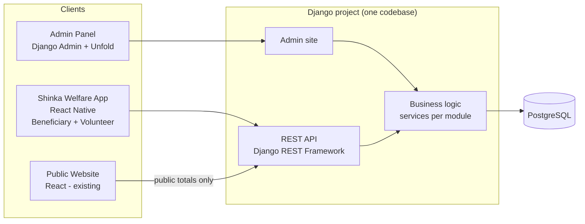

**What you build:** 2 things. The **Django project** (API + admin panel) and the **mobile app**. The public website already exists.

> ### 🎓 Learn: client–server and the "single source of truth"
> A **client** is anything a person touches (app, browser). A **server** holds the rules and the data.
> Clients never talk to the database directly. They ask the server through an **API**, and the server decides what is allowed.
> Why: if the mobile app could write to the database itself, anyone who copies the app could change data. Keeping all rules on the server means there is **one place** where the truth lives and one place to fix bugs.

> ### 🎓 Learn: modular monolith (not microservices)
> A **monolith** is one deployable application. **Microservices** split the system into many small apps that talk over the network.
> Microservices help big companies with many teams, but for one developer they add huge cost: many deployments, network failures, data spread across databases.
> We use a **modular monolith**: one Django project, divided into clear **apps** (modules) with clean boundaries. If one module ever needs to become its own service, the boundary already exists.

---

## 2. Standard systems studied

Big aid organisations have already solved this problem. The design copies their proven ideas at village scale.

| System | Who uses it | What we take from it |
|---|---|---|
| **WFP SCOPE** (UN World Food Programme) | Millions of aid recipients worldwide | The full chain **Registration → Entitlement → Distribution cycle → Reconciliation**. Register a **household once** and reuse it for every program. Field registration on mobile. Compare *planned* vs *actually received* after every distribution. |
| **Salesforce Nonprofit Cloud – Program Management** | Large NGOs | The data model: **Program → Program Enrollment → Benefit Assignment → Benefit Schedule / Session → Benefit Disbursement**. This is exactly how a beneficiary can see "what I received" and "what is coming". |
| **BISP / NSER** (Pakistan) | Benazir Income Support Programme | **Household survey + proxy-means-test score (0–100)** to decide eligibility fairly, with a cutoff set according to available funds. We use a simple local version (a "need score"). |
| **CiviCRM** (open-source nonprofit CRM) | Thousands of charities | Contacts, **contributions (donations) with receipts**, case management, activity history. |
| **UNHCR registration practice** | Refugee programmes | Household-based records with individual members, document checks, and strict data protection. |

> ### 🎓 Learn: study before you design
> Most business problems are already solved somewhere. Before designing, find a mature system in the same domain and copy its **concepts** (not its code). Here, WFP and Salesforce taught us that "planned benefit" and "delivered benefit" must be **separate records**. Without that idea, "upcoming benefits" would be impossible to build.

---

## 3. Technology stack

### 3.1 Final choices

| Part | Choice | Why |
|---|---|---|
| Language | **Python 3.12+** | Clean, readable, huge ecosystem (also useful for your ML/data work later) |
| Web framework | **Django 5.2 LTS** (upgrade to 6.2 LTS when released, expected April 2027) | Batteries included: ORM, migrations, auth, permissions, admin panel, security defaults |
| REST API | **Django REST Framework (DRF)** | The standard way to build APIs in Django: serializers, viewsets, permissions, throttling |
| API docs | **drf-spectacular** | Generates an **OpenAPI** spec + Swagger UI automatically; mobile types are generated from it |
| Mobile auth | **djangorestframework-simplejwt** | JWT access + refresh tokens for the mobile app |
| Admin panel | **Django Admin + django-unfold** | A modern admin UI with dashboards, filters, actions, almost for free |
| Database | **PostgreSQL 16** | Transactions and constraints for money; `JSONField` for survey answers |
| Background jobs | **Celery + Redis**, **Celery Beat** for schedules | WhatsApp/SMS, PDFs, push notifications, nightly entitlement generation |
| Filtering | **django-filter** | `?status=ready&mohalla=3` filters on API lists |
| Audit history | **django-simple-history** | Stores every version of important records automatically |
| Import / export | **django-import-export** | Excel import of old beneficiary lists, Excel export of reports |
| Files | **django-storages** → **Cloudflare R2** (S3-compatible) | Photos, receipts, signatures, PDFs |
| PDF reports | **WeasyPrint** | HTML template → PDF, supports Urdu fonts |
| Encryption | **cryptography** (Fernet) in a custom model field | Encrypt CNIC numbers at rest |
| Tests | **pytest-django + factory_boy** | Fast tests with fake data factories |
| Server | **Gunicorn + Nginx**, Docker Compose | Standard, proven Python deployment |
| Errors | **Sentry** (free tier) | See crashes in production with full details |
| Mobile app | **React Native (Expo) + TypeScript**, **expo-sqlite** for offline | One codebase, push notifications, over-the-air updates |

> ### 🎓 Learn: LTS versions
> **LTS = Long-Term Support.** Django releases a new version every ~8 months, but only every third one (x.2) gets ~3 years of security fixes.
> For a system that must run for years with little maintenance, always start on an LTS. Upgrade from one LTS to the next, not every release.

> ### 🎓 Learn: "batteries included" vs "micro" frameworks
> Django includes ORM, admin, auth and security out of the box. FastAPI and Flask are "micro": faster and lighter, but you add and wire every piece yourself.
> For a data-heavy business system with an admin panel and permissions, batteries included saves months. For a tiny high-speed API, a micro framework can be better.

### 3.2 Laravel → Django dictionary (for you)

| Laravel | Django | Notes |
|---|---|---|
| `artisan` | `manage.py` | `python manage.py runserver`, `migrate`, `createsuperuser`, `shell` |
| Project → modules (folders) | Project → **apps** | Each module (`finance`, `registry`…) is a Django app |
| Eloquent Model | **Model** (`models.py`) | Fields are declared in the class; migrations are **generated** from them |
| Migrations (written by hand) | `makemigrations` → `migrate` | Django compares models with the DB and writes the migration for you |
| `routes/api.php` | `urls.py` + DRF **Router** | |
| Controller | **View / ViewSet** | A `ModelViewSet` gives list/create/retrieve/update/delete in a few lines |
| Form Request validation + API Resource | **Serializer** | One class validates input *and* formats output |
| Policy / Gate | **Permission classes** + `get_queryset()` filtering | |
| Middleware | Middleware | Same idea |
| Sanctum | **SimpleJWT** (mobile), session auth (admin) | |
| spatie/laravel-permission | Built-in **Groups + Permissions** | Django has this natively |
| Filament / Nova | **Django Admin** (+ Unfold theme) | Built in |
| Queues + Horizon | **Celery** + **Flower** | |
| Scheduler (`schedule:run`) | **Celery Beat** | |
| Events / Listeners / Observers | **Signals** (use sparingly) or explicit service calls | |
| Blade | Django Templates | Only used for admin pages and PDFs here |
| `DB::transaction()` | `transaction.atomic()` | |
| `lockForUpdate()` | `select_for_update()` | |
| Factories / Seeders | **factory_boy** / data migrations, management commands | |
| `.env` | `.env` read by **django-environ** | |
| PHPUnit / Pest | **pytest** | |

---

## 4. Design principles

1. **One backend, one database, one truth.** No Excel sheets on the side.
2. **Household first.** Aid is given to households; members are linked to them. Register once, reuse everywhere (SCOPE).
3. **Plan before you give.** Every benefit is first an *entitlement* (planned), then a *distribution* (given).
4. **Two people for money.** Any money in or out needs a *maker* and a *checker*. Nobody approves their own entry.
5. **Privacy by default.** Beneficiary names never appear publicly. Public data is totals only.
6. **Offline first for volunteers.** Field work works without internet and syncs later.
7. **Urdu first.** Every app screen in Urdu (right-to-left), English optional. Big buttons and icons.
8. **Low running cost.** Runs on one small server.
9. **Ready for other societies.** Every record carries a `society` link from day one (multi-tenant).
10. **Business logic in services, not in views.** (See 🎓 below.)

> ### 🎓 Learn: where business logic lives — "fat services, thin views"
> A common beginner mistake is writing all logic inside API views. Then the same rule (e.g. "approve a donation") must be copied into the admin panel, the Celery task and the tests, and the copies drift apart.
> Instead, each module has a **`services.py`** with plain functions like `approve_donation(donation, approver)`. The API view, the admin action and the Celery task all **call the same function**. One rule, one place.
> ```python
> # finance/services.py
> @transaction.atomic
> def approve_donation(donation: Donation, approver: User) -> Donation:
>     if donation.created_by_id == approver.id:
>         raise PermissionDenied("Maker cannot approve own entry")
>     donation.status = Donation.Status.APPROVED
>     donation.approved_by = approver
>     donation.save()
>     post_donation_to_ledger(donation)          # double-entry
>     send_receipt.delay(donation.id)             # Celery, after commit
>     return donation
> ```

---

## 5. Users and roles

### 5.1 Roles

| Role | Description | Uses |
|---|---|---|
| **Super Admin** | Technical owner (developer) | Admin panel |
| **President / Committee Admin** | Sees everything, approves big decisions | Admin panel |
| **Finance Secretary** | Donations, expenses, ledger, monthly close | Admin panel |
| **General Secretary / Program Coordinator** | Programs, beneficiaries, distribution planning | Admin panel |
| **Auditor** (optional) | Read-only access to finance and audit history | Admin panel |
| **Volunteer** | Field surveys, verification, distribution, ambulance trips, cash collection | Mobile app (volunteer dashboard) |
| **Beneficiary** (household head) | Sees own household's help received and upcoming; applies for help | Mobile app (beneficiary dashboard) |
| **Donor** (phase 5, optional) | Sees own donations and receipts | Mobile app / web |
| **Public** | Not logged in | Public website |

### 5.2 Permission matrix (summary)

| Module | Super Admin | President | Finance Sec. | Program Coord. | Volunteer | Beneficiary |
|---|---|---|---|---|---|---|
| Users & roles | ✅ full | ✅ full | 👁 view | 👁 view | – | – |
| Households & members | ✅ | ✅ | 👁 | ✅ | ✏️ assigned only | 👁 own only |
| Assessments / need score | ✅ | ✅ approve | – | ✏️ | ✏️ submit | – |
| Programs & cycles | ✅ | ✅ approve | 👁 | ✏️ | 👁 | – |
| Enrollments & entitlements | ✅ | ✅ approve | 👁 | ✏️ | 👁 assigned | 👁 own |
| Distributions | ✅ | ✅ | 👁 | ✏️ | ✏️ record | 👁 own |
| Applications (requests for help) | ✅ | ✅ decide | 👁 | ✏️ review | ✏️ verify | ✏️ submit own |
| Donations | ✅ | 👁 | ✏️ + approve | 👁 | ✏️ record (pending) | – |
| Expenses | ✅ | ✅ approve > limit | ✏️ + approve | ✏️ request | ✏️ request | – |
| Ledger & reports | ✅ | 👁 | ✏️ close month | 👁 | – | – |
| Ambulance | ✅ | 👁 | 👁 costs | ✏️ | ✏️ trips | ✏️ request |
| Audit history | ✅ | 👁 | 👁 | – | – | – |

✅ full · ✏️ create/edit · 👁 view · – none

**Conflict-of-interest rule:** a volunteer can never verify, approve or distribute to their **own** household or close relatives.

> ### 🎓 Learn: RBAC and the two layers of authorization
> **Authentication** = *who are you?* (login). **Authorization** = *what may you do?*
> **RBAC (Role-Based Access Control):** permissions like `finance.approve_donation` are grouped into roles (Django **Groups**). Users get roles, not individual permissions, so the committee can change a role once and it applies to everyone.
> RBAC alone is not enough. A beneficiary has permission to "view households", but only **their own**. That second layer is **object-level** (or row-level) authorization. In Django/DRF it is done in two places:
> ```python
> class MyHouseholdViewSet(viewsets.ReadOnlyModelViewSet):
>     permission_classes = [IsAuthenticated, IsBeneficiary]       # layer 1: role
>     def get_queryset(self):                                       # layer 2: rows
>         return Household.objects.filter(users=self.request.user)
> ```
> Filtering in `get_queryset()` is the safest pattern: records the user may not see simply **don't exist** for them, so you can't forget a check.

---

## 6. System architecture

### 6.1 Context

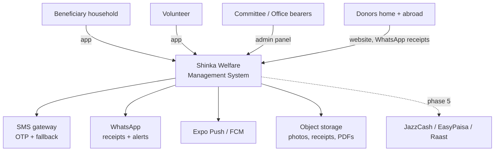

### 6.2 Containers (what runs where)

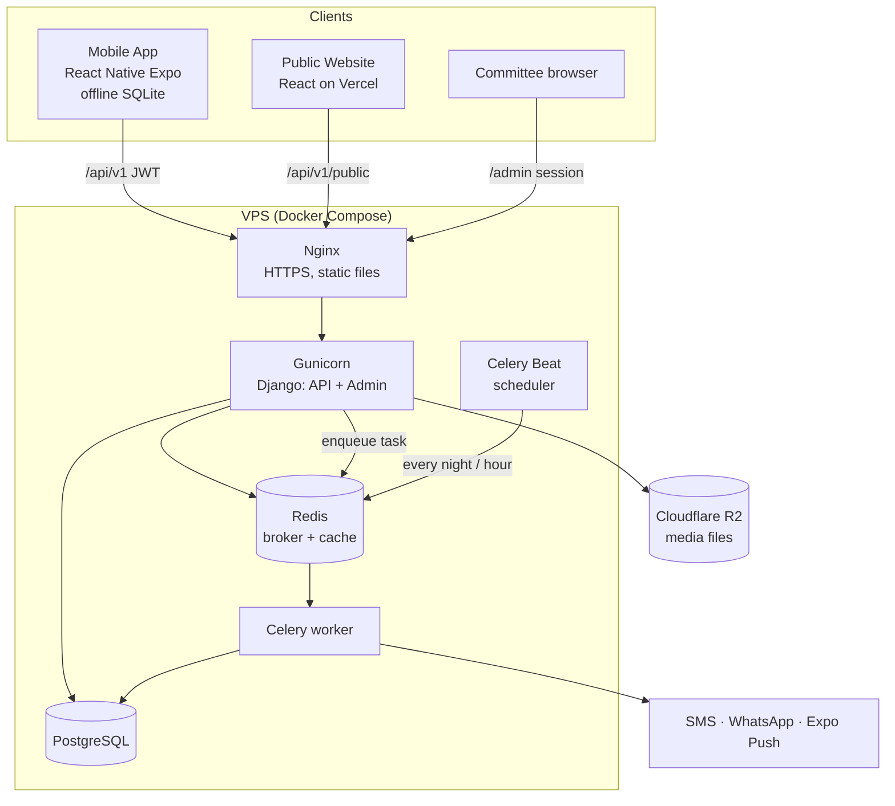

> ### 🎓 Learn: the C4 model
> These diagrams follow the **C4 model**, a standard way to draw architecture at zoom levels:
> 1. **Context** — the system as one box, with people and outside systems around it (6.1).
> 2. **Containers** — things that run separately: apps, servers, databases (6.2).
> 3. **Components** — modules inside one container (section 7).
> 4. **Code** — classes and functions (only where needed).
> Always start from the top. People get lost when the first diagram is full of classes.

> ### 🎓 Learn: why Gunicorn, Nginx, Celery and Redis?
> - **Django** is your code. It cannot face the internet alone.
> - **Gunicorn** runs several Django **worker processes**, so many requests are handled at once.
> - **Nginx** sits in front: handles HTTPS, serves static files fast, and passes the rest to Gunicorn (a "reverse proxy").
> - **Celery** runs slow work in the background (send 500 WhatsApp messages, build a PDF). The API answers instantly instead of making the user wait.
> - **Redis** is the **message broker**: the API drops a job into Redis; a Celery worker picks it up. It also works as a cache.
> - **Celery Beat** is the clock: "every night at 2 AM, generate entitlements", like cron.

> ### 🎓 Learn: one app, two dashboards
> Beneficiaries and volunteers use **one** mobile app. After login, the API returns the user's roles and the app shows the right dashboard.
> One install, one Play Store listing, one codebase. A user with both roles gets a switcher. The **server** still enforces permissions; hiding a button in the app is convenience, not security.

---

## 7. Modules (Django apps)

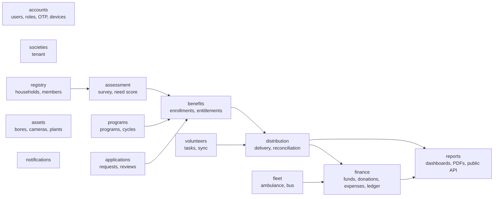

| App | Responsibility |
|---|---|
| `societies` | The tenant: each welfare society, its settings, approval limits |
| `accounts` | Custom User (phone login), roles, OTP, PIN, registered devices |
| `registry` | Households, members, mohalla, CNIC, documents, photos, status |
| `assessment` | Household survey (JSON), **need score 0–100**, eligibility per program |
| `programs` | Programs and their cycles (e.g. "Ramadan 2027") with budget and rules |
| `benefits` | Enrollments; scheduled entitlements (**what is coming**) |
| `distribution` | What was actually given (QR scan, photo, thumb/signature); reconciliation |
| `applications` | Beneficiary requests help → verification → committee decision |
| `finance` | Funds (Zakat, Sadaqah, General, per cause), donors, donations + receipts, expenses + approvals, ledger, monthly close |
| `volunteers` | Volunteer profiles, task assignment, offline sync endpoints |
| `fleet` | Ambulance and college bus: requests, trips, drivers, fuel, maintenance |
| `assets` | Water bores, filter plants, CCTV cameras, streetlights, bins |
| `notifications` | Push, SMS, WhatsApp templates in Urdu; delivery log |
| `reports` | Dashboards, monthly PDF, public totals API |

Each app has the same inside layout:

```
finance/
├── models.py        # data (tables)
├── services.py      # business rules (write operations)
├── selectors.py     # reusable read queries
├── serializers.py   # API input validation + output format
├── api.py           # DRF viewsets
├── admin.py         # admin panel screens
├── permissions.py   # DRF permission classes
├── tasks.py         # Celery background jobs
├── tests/
└── migrations/
```

> ### 🎓 Learn: bounded contexts and dependency direction
> A **bounded context** is a part of the system with its own words and rules. "Fund" means something exact inside `finance`; `registry` doesn't need to know how a ledger works.
> Rule: dependencies point **one way** (arrows above). `distribution` may call `finance.services.record_distribution_cost()`, but `finance` never imports `distribution`. If two apps import each other, you have a **circular dependency**, a sign the boundary is wrong.

> ### 🎓 Learn: services vs selectors
> **Services** change data (`approve_donation`). **Selectors** read data (`household_summary(household, year)`). Separating them keeps reads safe to reuse anywhere (API, admin dashboard, PDF report) without side effects.

---

## 8. Core concept: how "received" and "upcoming" work

This is the heart of the system, modelled on SCOPE and Salesforce Nonprofit Cloud.

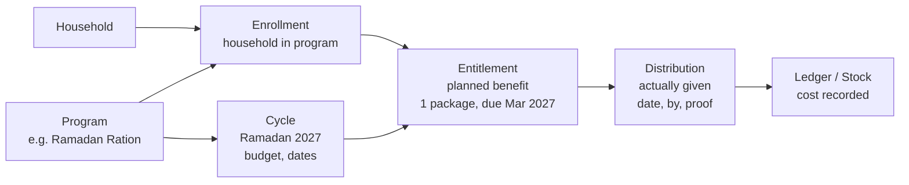

| Term | Meaning | Example |
|---|---|---|
| **Program** | A type of help the society offers | Education Fund |
| **Cycle** | One round of a program, with dates and budget | Education Fund – Term 1, 2027 |
| **Enrollment** | A household or person is accepted into a program | Ayesha (daughter) enrolled in Education Fund |
| **Entitlement** | A *planned* benefit, with amount and due date | Rs 1,500 fee for Ayesha, due 10 Apr 2027 |
| **Distribution** | The benefit *actually given*, with proof | Rs 1,500 paid to school on 8 Apr 2027, receipt photo |

**What the beneficiary sees:**
- **Received** = all `Distribution` rows for their household (totals per program and year).
- **Upcoming** = all `Entitlement` rows with status `planned` / `confirmed` / `ready` and a future due date.
- Upcoming items are always labelled **"Expected — depends on available funds"** until confirmed.

### 8.1 Entitlement statuses (state machine)

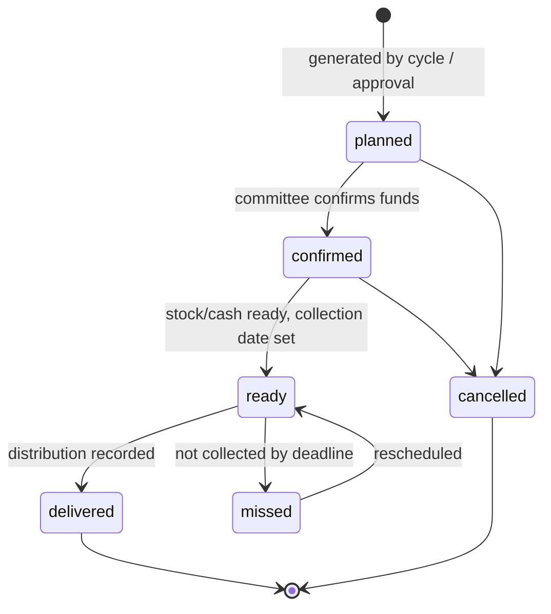

> ### 🎓 Learn: state machines
> Anything with a lifecycle (entitlement, application, donation, expense) should be a **state machine**: a fixed list of states and the **allowed moves** between them.
> Without it, bugs like "delivered → planned" or "rejected → paid" appear. In Django, keep the status in a `TextChoices` field and allow changes **only through service functions** that check the move:
> ```python
> ALLOWED = {
>     "planned":   {"confirmed", "cancelled"},
>     "confirmed": {"ready", "cancelled"},
>     "ready":     {"delivered", "missed"},
>     "missed":    {"ready"},
> }
> def change_status(ent, new):
>     if new not in ALLOWED.get(ent.status, set()):
>         raise ValidationError(f"{ent.status} → {new} not allowed")
> ```
> (Libraries like `django-fsm-2` or `viewflow.fsm` do this with decorators.)

### 8.2 Shinka's programs mapped to the model

| Program (from website) | Type | Benefit unit | How entitlements are created |
|---|---|---|---|
| Education Fund (635 students, Rs 380k/yr) | Recurring, per **student** | Fee amount (PKR) | One per student per term/month after enrollment |
| College Bus (35 girls) | Recurring service | Seat | Seat assignment per academic year |
| AIOU higher education (3 girls) | Recurring, per student | Fees + books | Per semester |
| Ramadan Food Package | Annual cycle, per **household** | 1 package (items list) | Generated for all eligible households when the cycle is created |
| Eid-ul-Adha meat | Annual cycle, per household | 5 kg meat | Generated for all eligible households |
| Marriage Fund (Rs 150,000) | One-time, via **application** | Cash + items | Created when the committee approves; due on wedding date |
| Water Bore (Rs 45,000) | One-time, via application | 1 bore (asset) | Waiting list with position; entitlement when funded |
| Burial Fund | On-demand, via application | Kafan + costs | Fast-track approval (same day) |
| Ambulance | On-demand **service** | Trip | Not an entitlement: logged as a free service to the household |
| Filtered water, cleanliness, security | Community service | — | Tracked as **assets/projects** and expenses, not per household |

---

## 9. Data model

### 9.1 Entity-relationship diagram (core)

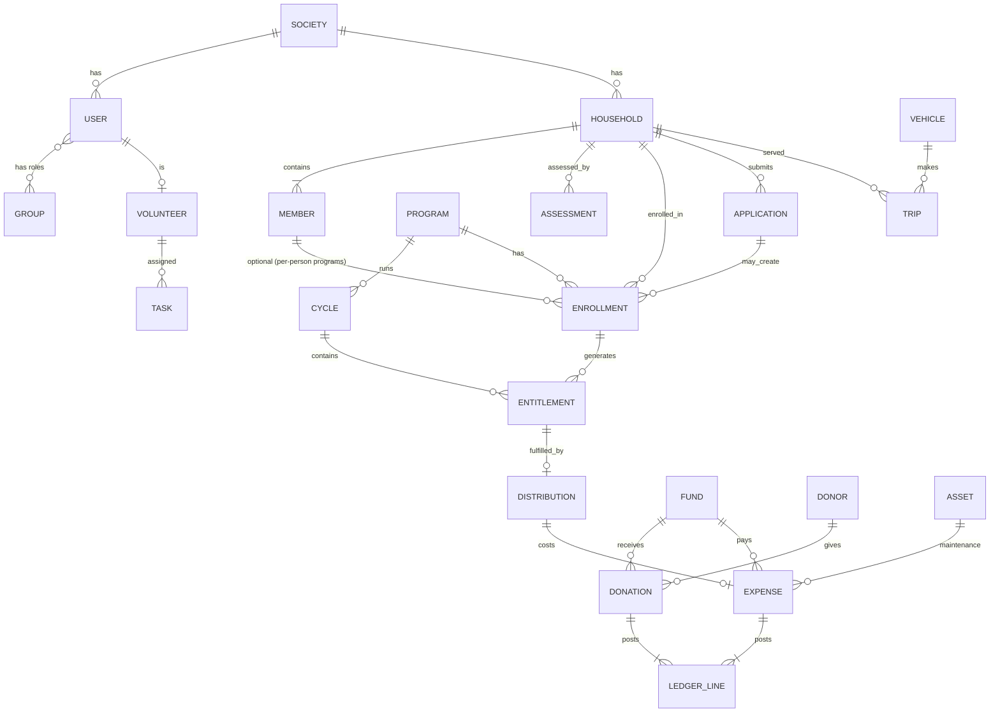

### 9.2 Common base model

Every table inherits from one abstract base:

```python
# core/models.py
import uuid
from django.db import models

class TenantModel(models.Model):
    id = models.UUIDField(primary_key=True, default=uuid.uuid4, editable=False)
    society = models.ForeignKey("societies.Society", on_delete=models.PROTECT)
    created_at = models.DateTimeField(auto_now_add=True)
    updated_at = models.DateTimeField(auto_now=True)
    created_by = models.ForeignKey("accounts.User", null=True,
                                   on_delete=models.SET_NULL, related_name="+")

    objects = SocietyManager()   # always filters by current society

    class Meta:
        abstract = True
```

> ### 🎓 Learn: UUIDs instead of 1, 2, 3
> Auto-increment IDs (`/households/42`) leak information (how many households) and let people guess other IDs. They also **clash** when an offline phone creates a record before talking to the server.
> **UUIDs** can be created anywhere (even offline on the phone) without collisions. That's essential for our offline sync.

> ### 🎓 Learn: multi-tenancy
> **Multi-tenant** = one system serving many customers (tenants), each seeing only their own data. Three common designs:
> 1. **Shared tables + `society_id` column** ← we use this. Simplest; one database.
> 2. **Schema per tenant** (e.g. `django-tenants`): stronger isolation, more complex.
> 3. **Database per tenant**: strongest isolation, most expensive.
> With option 1 the danger is forgetting the filter. That's why every model uses a **custom manager** that filters by the current society automatically, and tests check that society A can never see society B's rows.

### 9.3 Main models

**societies / accounts**

| Model | Key fields |
|---|---|
| `Society` | name, slug, logo, settings (JSON: approval limits, collection points) |
| `User` (custom, `AbstractBaseUser`) | phone (unique, login field), name, pin (hashed), language, is_active, last_login |
| `Group` / `Permission` | Django built-in = roles and permissions |
| `Device` | user, push_token, platform, approved, last_seen |
| `OTP` | phone, code_hash, expires_at, attempts |

> ### 🎓 Learn: always start with a custom User model
> Django's docs recommend creating a **custom User model at the very start** of every project, even if it looks the same as the default. Changing it later, after the first migration, is very painful.
> Ours logs in with **phone** instead of username: `USERNAME_FIELD = "phone"`.

**registry / assessment**

| Model | Key fields |
|---|---|
| `Household` | code (e.g. SHK-0421), head (→ Member), mohalla, address, location (lat/lng), phone, status, need_score, tier, registered_by, verified_by, verified_at |
| `Member` | household, full_name, father_or_husband_name, relation, gender, dob, cnic (encrypted), cnic_hash, is_disabled, is_orphan, is_widow, education_level, school |
| `HouseholdUser` | household, user (which app accounts can see this household) |
| `Document` | generic link (owner), type (CNIC, B-form, death certificate, fee slip…), file, verified |
| `Assessment` | household, answers (`JSONField`), score, scored_by, approved_by, valid_until |

**programs / benefits / distribution**

| Model | Key fields |
|---|---|
| `Program` | code, name_en, name_ur, kind (recurring/annual/one_time/on_demand/service), unit (cash/package/kg/seat/trip), default_amount, eligibility_rules (JSON), requires_application, fund |
| `Cycle` | program, name ("Ramadan 2027"), starts_on, ends_on, budget, status (draft/active/closed) |
| `Enrollment` | program, household, member (nullable), status, start_date, end_date, approved_by, source_application |
| `Entitlement` | enrollment, cycle, due_date, quantity, unit, amount_pkr, status, collection_point |
| `Distribution` | entitlement (**one-to-one**), household, delivered_at, quantity, amount_pkr, delivered_by, received_by (Member), proof_photo, signature, location, method (qr/manual), client_uuid (unique) |
| `PackageItem` | cycle, item, qty, unit_cost |

**applications**

| Model | Key fields |
|---|---|
| `Application` | household, program, details (JSON), amount_requested, status, urgency, submitted_via (app/volunteer/office) |
| `Review` | application, reviewer, step, decision, comment |

**finance**

| Model | Key fields |
|---|---|
| `Fund` | name (Zakat, Sadaqah, General, Education, Ambulance, Marriage…), is_restricted, zakat_only |
| `Donor` | name, phone, country, city, is_anonymous, receipt_channel |
| `Donation` | donor, fund, amount (Decimal), currency, amount_pkr, method (cash/bank/JazzCash/EasyPaisa/Raast), reference, received_at, collected_by, status (pending/approved/rejected), approved_by, receipt_no |
| `Expense` | fund, category, amount, paid_to, paid_at, method, bill_photo, linked object (distribution/asset/trip/salary), requested_by, approved_by, status |
| `Account` | chart of accounts: Cash in hand, Bank, JazzCash, each Fund, expense heads |
| `JournalEntry` + `LedgerLine` | entry: date, description, source; lines: account, debit, credit |
| `MonthlyClose` | period (2027-03), totals (JSON), report_pdf, closed_by, published_at |
| `Staff` / `Payroll` | sanitation workers, guard, drivers |

> ### 🎓 Learn: money rules every developer must know
> 1. **Never use float for money.** `0.1 + 0.2 = 0.30000000000000004`. Use `DecimalField(max_digits=12, decimal_places=2)` and Python's `Decimal`.
> 2. **Double-entry bookkeeping.** Every transaction creates at least two ledger lines whose **debits equal credits**. A Rs 10,000 cash donation to the Education fund:
>    | Account | Debit | Credit |
>    |---|---|---|
>    | Cash in hand | 10,000 | |
>    | Education Fund | | 10,000 |
>    If debits ≠ credits, the books are wrong, and the system can detect it automatically.
> 3. **Never edit or delete posted money.** Mistakes are fixed with a **reversing entry**. The history stays complete, which is what auditors (and donors) trust.
> 4. **Lock closed months.** After the monthly close, that period is read-only.
> 5. **Restricted funds.** Zakat money may only be spent on eligible people's needs. The `Fund.zakat_only` flag is checked in `services.create_expense()`.

**operations**

| Model | Key fields |
|---|---|
| `Volunteer` | user, mohalla, skills, own_household, related_households, active |
| `Task` | kind (survey/verify/distribute/visit), assigned_to, household, due_at, status, result (JSON) |
| `Vehicle` | registration_no, kind (ambulance/bus), status |
| `Trip` | vehicle, driver, household, requested_at, origin, destination (Hazro THQ, DHQ Attock, PIMS…), km_start, km_end, fuel_cost, status |
| `Asset` | kind (water bore, filter plant, camera, streetlight, bin), location, cost, installed_on, fund, status |
| `Notification` | user, channel, template, payload, status, sent_at |
| History tables | created automatically by `django-simple-history` for important models |

> ### 🎓 Learn: database constraints are your last line of defence
> Code has bugs; the database should still refuse bad data. Put rules **in the database**, not only in Python:
> ```python
> class Distribution(TenantModel):
>     entitlement = models.OneToOneField(Entitlement, on_delete=models.PROTECT)  # can't deliver twice
>     client_uuid = models.UUIDField(unique=True)                                # offline retry is safe
>     class Meta:
>         constraints = [
>             models.CheckConstraint(condition=models.Q(quantity__gt=0), name="qty_positive"),
>         ]
> ```
> `on_delete=PROTECT` stops anyone deleting a household that has distributions. Use `CASCADE` only when children truly have no meaning without the parent.

### 9.4 Need score (simple local proxy-means test)

| Factor | Points (example) |
|---|---|
| No earning member | +25 |
| Widow / female-headed household | +15 |
| Each disabled member | +10 |
| Each orphan child | +5 |
| Kacha house / rented | +10 |
| No agricultural land | +10 |
| Family members abroad sending money | −20 |
| Government job / business in family | −20 |
| Owns vehicle / large livestock herd | −10 |

Capped 0–100. Each program sets its own cutoff (e.g. Ramadan ration ≥ 40, Marriage Fund ≥ 55). Weights are **editable by the committee** in the admin panel and every change is recorded. The score is **never shown to the beneficiary**, only "eligible / not eligible", as BISP does.

---

## 10. Key workflows

### 10.1 Household registration and verification

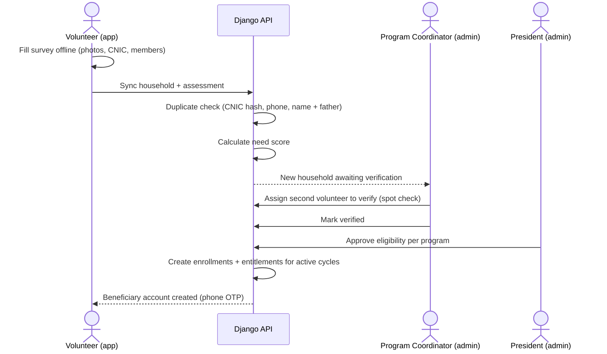

### 10.2 Beneficiary applies for help (e.g. marriage fund)

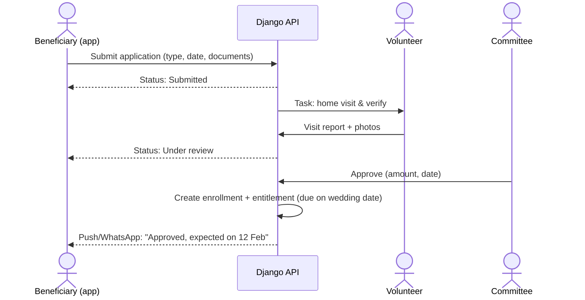

### 10.3 Distribution day (Ramadan ration / Eid meat)

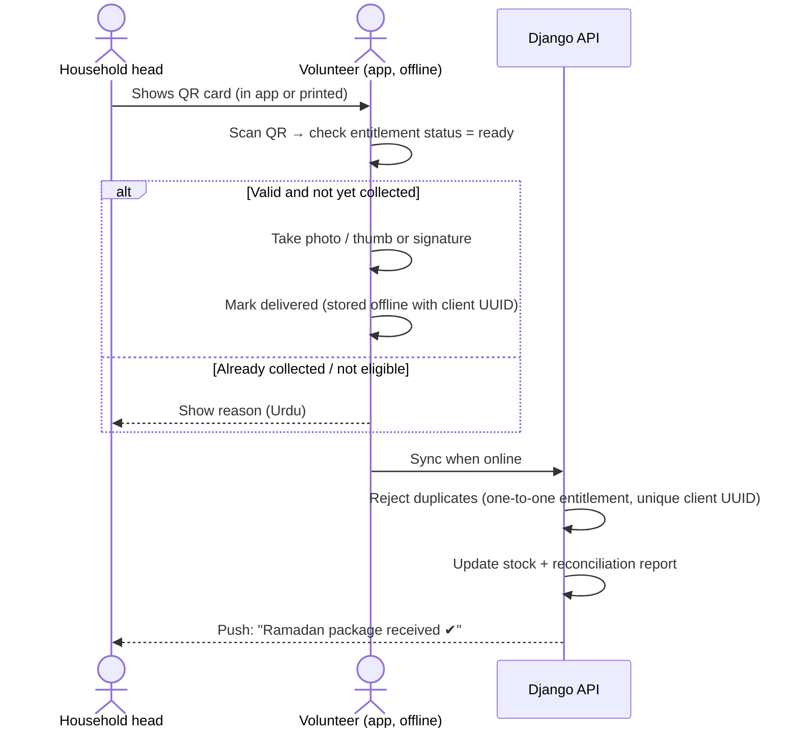

After each cycle: **planned vs delivered vs missed** per mohalla and per volunteer (as WFP SCOPE does).

> ### 🎓 Learn: race conditions and row locks
> Two volunteers scan the same QR card at the same second. Both read "status = ready", both write "delivered". That's a **race condition**.
> Fix it with a **transaction + row lock**, plus a unique constraint as a safety net:
> ```python
> @transaction.atomic
> def deliver(entitlement_id, volunteer, client_uuid, **proof):
>     ent = Entitlement.objects.select_for_update().get(id=entitlement_id)  # lock the row
>     if ent.status != Entitlement.Status.READY:
>         raise AlreadyDelivered()
>     Distribution.objects.create(entitlement=ent, delivered_by=volunteer,
>                                 client_uuid=client_uuid, **proof)
>     ent.status = Entitlement.Status.DELIVERED
>     ent.save(update_fields=["status"])
> ```
> The second request waits for the lock, then sees "delivered" and is refused.

### 10.4 Donation → receipt → ledger

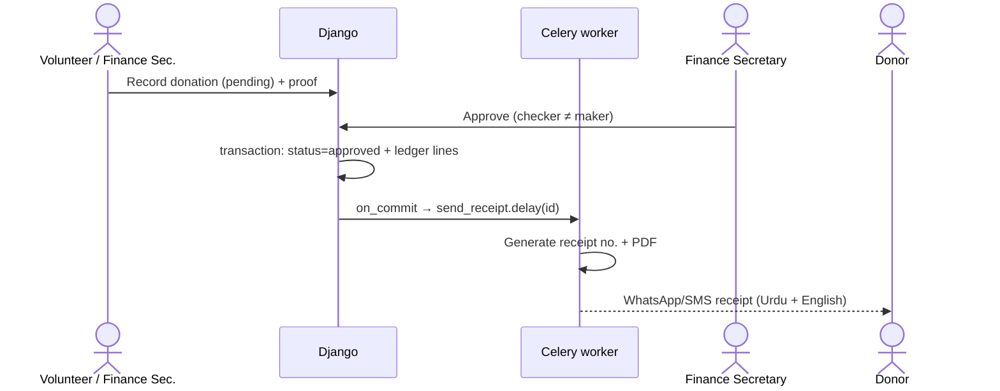

> ### 🎓 Learn: `transaction.on_commit()`
> If you queue a Celery task *inside* a transaction and the transaction later fails, the donor gets a receipt for a donation that doesn't exist. Always queue side effects **after** the commit:
> ```python
> transaction.on_commit(lambda: send_receipt.delay(donation.id))
> ```

### 10.5 Expense approval limits

| Amount | Approval needed |
|---|---|
| Up to Rs 10,000 | Finance Secretary |
| Rs 10,001 – 100,000 | Finance Secretary + General Secretary |
| Above Rs 100,000 | + President |

Limits live in `Society.settings`. Every expense needs a bill photo. A **Zakat** fund can only pay for eligible beneficiaries' direct needs, not salaries or cameras.

### 10.6 Ambulance request

Beneficiary taps **"Ambulance"** → call button (the phone is still fastest) + an optional request record with location → the driver's app gets the trip → the driver logs km and fuel → monthly cost per trip appears in reports.

---

## 11. App screens

### 11.1 Beneficiary dashboard (mobile)

| Screen | Content |
|---|---|
| **Home** | Greeting, household code, **"Received this year: Rs X + N packages"**, **next upcoming benefit**, ambulance button |
| **Received** (ملی ہوئی مدد) | Timeline of all distributions: date, program, amount/quantity, proof photo; totals per program |
| **Upcoming** (آنے والی مدد) | Entitlements with status badge (Expected / Confirmed / Ready – collect on date at place) |
| **My QR card** | Household QR for distribution day; works offline |
| **Apply for help** | Type → simple form → photo of documents → track status |
| **My household** | Members, enrolled programs (read only) |
| **Notifications** | Collection dates, approvals, reminders |
| **Help / Complaint** | Feedback or complaint, optionally anonymous, goes to the President |

**Households without a smartphone:** printed QR card + SMS/WhatsApp. The app is an extra channel, never the only one.

### 11.2 Volunteer dashboard (mobile)

| Screen | Content |
|---|---|
| **Today** | Assigned tasks; sync status ("3 records waiting to sync") |
| **Register household** | Step-by-step survey, camera for CNIC/house photos, GPS |
| **Verify** | Visit checklist for applications and new households |
| **Distribution mode** | Choose cycle → scan QR → confirm → photo/thumb; fully offline; delivered/remaining counter |
| **Collect donation** | Record cash donation → pending approval → donor receipt after approval |
| **Expense request** | Amount, category, bill photo |
| **Trips** (drivers) | Start/end trip, km, fuel |
| **My activity** | Tasks completed, households visited |

### 11.3 Admin panel (Django Admin + Unfold)

| Area | What it contains |
|---|---|
| **Dashboard** | Fund balances, this month in/out, beneficiary count, upcoming distributions, pending approvals |
| **Households** | Search/filter by mohalla, score, program; full history inline; duplicate review |
| **Applications** | Inbox by status; verification reports; **Approve / Reject** admin actions |
| **Programs & cycles** | Create cycle → **"Generate entitlements"** action → assign volunteers and collection points |
| **Distribution** | Live progress; reconciliation report |
| **Finance** | Donors, donations, expenses, approval queue, ledger, fund balances, **"Close month & publish"** action |
| **Assets, Fleet, Staff, Volunteers** | Standard list/detail screens |
| **Reports** | Monthly PDF (Urdu + English), Excel exports |
| **Settings** | Users & roles (Groups), approval limits, need-score weights, message templates |
| **History** | Every change to important records (simple-history) |

> ### 🎓 Learn: when Django Admin is enough, and when it isn't
> Django Admin is excellent for **trusted internal staff** doing data work: lists, filters, forms, bulk actions. That's exactly our committee.
> It is **not** meant for the public or for highly custom workflows. If the committee later needs very custom screens (e.g. a drag-and-drop distribution planner), build just that page as a custom admin view or a small React page. Don't rebuild the whole admin.
> Keep the admin thin, too: admin **actions** call the same `services.py` functions as the API.

### 11.4 Public website (existing site, upgraded)

- **Live Transparency page** from the published monthly close. Replaces the Facebook ledger photos (currently last updated August 2024).
- **Live impact counters** (students funded, weddings, bores, packages) from real data instead of hard-coded numbers in `src/data/site.js`.
- **Donation details** (bank, JazzCash, EasyPaisa) and a "Pledge / I donated" form that creates a *pending* donation.
- **Totals only. No beneficiary names, ever.**

---

## 12. API design

REST + JSON, versioned under `/api/v1/`. Mobile uses **JWT** (SimpleJWT). The admin panel uses Django sessions. Every view has **permission classes** and a filtered `get_queryset()`.

| Group | Example endpoints |
|---|---|
| Auth | `POST /auth/otp/request/`, `POST /auth/otp/verify/`, `POST /auth/pin/login/`, `POST /auth/token/refresh/`, `GET /me/` |
| Beneficiary (own data only) | `GET /me/household/`, `GET /me/summary/`, `GET /me/distributions/`, `GET /me/entitlements/?status=upcoming`, `GET /me/qr/`, `POST /me/applications/` |
| Volunteer | `GET /volunteer/tasks/`, `POST /sync/push/`, `GET /sync/pull/?since=…`, `POST /distributions/deliver/`, `POST /donations/` (pending), `POST /expenses/` (request) |
| Public (no auth, cached) | `GET /public/impact/`, `GET /public/transparency/?year=2027`, `GET /public/programs/`, `POST /public/pledges/` (throttled) |
| Docs | `GET /api/schema/` (OpenAPI), `GET /api/docs/` (Swagger UI) |

Example: `GET /api/v1/me/summary/`

```json
{
  "household_code": "SHK-0421",
  "year": 2027,
  "received": {
    "total_cash_pkr": "18500.00",
    "items": [
      { "program": "Education Fund", "count": 6, "amount_pkr": "9000.00" },
      { "program": "Ramadan Package", "count": 1, "quantity": "1 package" },
      { "program": "Eid-ul-Adha", "count": 1, "quantity": "5 kg" }
    ]
  },
  "upcoming": [
    { "program": "Education Fund", "due_date": "2027-04-10",
      "amount_pkr": "1500.00", "status": "confirmed", "label_ur": "تصدیق شدہ" },
    { "program": "Eid-ul-Adha", "due_date": "2027-05-17", "quantity": "5 kg",
      "status": "planned", "note": "Expected — depends on available funds" }
  ]
}
```

How that endpoint looks in Django (thin view, logic in a selector):

```python
# benefits/api.py
class MySummaryView(APIView):
    permission_classes = [IsAuthenticated, IsBeneficiary]

    def get(self, request):
        household = get_object_or_404(Household, users=request.user)
        year = int(request.query_params.get("year", timezone.now().year))
        data = selectors.household_summary(household, year)   # all logic here
        return Response(HouseholdSummarySerializer(data).data)
```

> ### 🎓 Learn: REST basics
> - **Resources are nouns**, HTTP methods are verbs: `GET /donations/` (list), `POST /donations/` (create), `GET /donations/{id}/`, `PATCH`, `DELETE`.
> - **Actions** that aren't simple edits get their own endpoint: `POST /donations/{id}/approve/`.
> - **Status codes** matter: 200 OK, 201 Created, 400 bad input, 401 not logged in, 403 not allowed, 404 not found, 409 conflict (already delivered).
> - **Version the API** (`/v1/`). Old app versions on villagers' phones will keep calling it for months; you can't break them.
> - **Paginate** every list (`?page=2`), so one request never returns 10,000 rows.

> ### 🎓 Learn: API contract first
> `drf-spectacular` publishes an **OpenAPI** file describing every endpoint. The mobile app generates its TypeScript types from it (`openapi-typescript`).
> If the backend changes a field name, the mobile build fails at compile time instead of crashing on a villager's phone.

---

## 13. Authentication

| User | Login method | Notes |
|---|---|---|
| Beneficiary | Phone + **OTP** first time → sets a **4-digit PIN** | Saves SMS costs. One account per household; can link 2 phones (e.g. son abroad can view) |
| Volunteer | Phone + OTP → PIN; device **registered and approved** by an admin | A lost phone can be blocked from the admin panel |
| Admin | Phone/email + password + OTP **2FA** | Session timeout 30 min |

Accounts are **created by the society** during registration, not by self sign-up. That prevents fake beneficiaries.

> ### 🎓 Learn: JWT access and refresh tokens
> After login, the server gives the app two tokens:
> - **Access token**: short life (e.g. 15 minutes), sent with every request (`Authorization: Bearer …`). If stolen, it expires quickly.
> - **Refresh token**: long life (e.g. 30 days), stored securely on the phone (`expo-secure-store`), used only to get a new access token.
> To log a lost phone out, **blacklist** its refresh token (SimpleJWT supports this) and block the device.
> Never store tokens in plain storage, and never put a CNIC or PIN inside a token. JWTs are signed, **not encrypted**; anyone can read their contents.

---

## 14. Security and privacy

| Data | Sensitivity | Protection |
|---|---|---|
| CNIC numbers | High | Encrypted at rest (Fernet); separate SHA-256 hash (with a secret pepper) for duplicate checks; shown masked (`37101-*****-3`) |
| Need score, survey answers | High | Admin/coordinator only; never shown to beneficiary or public |
| Marriage, burial, medical cases | High | Visible only to assigned reviewers and committee |
| Photos of homes and people | Medium–High | Private bucket, signed URLs that expire in 10 minutes |
| Donor identity | Medium | Donor can choose to be anonymous in all reports |
| Totals and impact numbers | Public | Only aggregated data goes to the public API |

Other controls:
- HTTPS everywhere; run `python manage.py check --deploy` before every release (Django's built-in security checklist).
- `DEBUG = False` in production; secrets only in environment variables.
- DRF **throttling** on OTP and public endpoints.
- **Maker-checker** on all money; closed months locked; corrections only by reversing entries.
- Change history on all important models (simple-history).
- Daily encrypted database backups to a separate location, kept 30 days; **monthly restore test**.
- **Consent** recorded at registration for data use and photos.
- Data retention: inactive households archived; personal data deleted on request where not needed for financial records.
- Follow Pakistan's data protection rules as they come into force; keep personal data minimal regardless.

> ### 🎓 Learn: hashing vs encryption
> - **Hashing** is one-way: you can't get the original back. Used for **PINs/passwords** (Django's `make_password`) and for **finding duplicates** (same CNIC → same hash).
> - **Encryption** is two-way with a key. Used when authorised staff must **see** the value again (CNIC on a verification screen).
> We store **both** for CNIC: the encrypted value to display, the hash to search. Searching encrypted data directly is impossible, which is why the hash exists.

> ### 🎓 Learn: defence in depth
> No single protection is enough. Here a beneficiary's data is protected by: HTTPS → login → role check → row filtering → encryption at rest → private file URLs → audit history → backups. If one layer fails, the next still holds.

---

## 15. Offline sync (volunteer app)

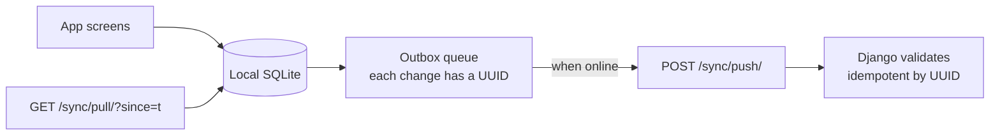

- Every record created offline gets a **client UUID**, so retrying never creates duplicates.
- **Pull** brings down only what the volunteer needs: assigned households, active-cycle entitlements for their area, QR verification data.
- **Conflict rules**: the server wins for approvals and statuses; distributions are append-only (the second delivery of the same entitlement is rejected and flagged).
- Photos upload in the background on good connection.
- The app shows "X records not yet synced" and blocks logout until synced.

> ### 🎓 Learn: idempotency
> An operation is **idempotent** if doing it twice has the same effect as doing it once.
> Phones on weak 3G often send a request, lose the reply, and retry. Without idempotency, one ration delivery becomes two in the database.
> Solution: the phone generates the UUID; the server stores it with a **unique constraint**. A retry finds the existing row and returns it instead of creating a new one.

> ### 🎓 Learn: offline-first
> **Online-first** apps call the server for every screen and break without internet. **Offline-first** apps read and write a **local database** and treat the server as something to sync with when possible.
> It's harder to build (sync and conflicts), so we use it **only for the volunteer field screens**, where it's essential. The beneficiary app can be mostly online, with the QR card cached offline.

---

## 16. Notifications

| Event | Channel | Example (Urdu in real templates) |
|---|---|---|
| Entitlement ready | Push + SMS | "Your Ramadan package is ready. Collect on 3 March at Society office." |
| Application status change | Push | "Your application has been approved." |
| Donation approved | WhatsApp / SMS to donor | "JazakAllah! Rs 10,000 received for Education Fund. Receipt #2027-0245" |
| Expense waiting approval | Push to approvers | "2 expenses waiting for your approval." |
| Monthly report published | WhatsApp channel / Facebook | "March 2027 accounts are published: link" |

All sending happens in **Celery tasks** with retries. Start cheap: Expo push (free) + WhatsApp **click-to-send links**. Move to the paid WhatsApp Business API and an SMS gateway when volume justifies it.

> ### 🎓 Learn: retries and backoff
> External services fail sometimes. A Celery task can retry automatically with **exponential backoff** (wait 1 min, 2, 4, 8…) so a short outage doesn't lose a receipt and doesn't hammer the provider:
> ```python
> @shared_task(autoretry_for=(ProviderError,), retry_backoff=True, max_retries=6)
> def send_receipt(donation_id): ...
> ```

---

## 17. Reports and dashboards

| Report | Audience |
|---|---|
| Monthly income & expenditure per fund (PDF, Urdu + English) | Committee, donors, website |
| Fund balances (Zakat / Sadaqah / General / per cause) | Finance, committee |
| Program report: beneficiaries, entitlements, delivered, missed, cost | Committee |
| Distribution reconciliation per cycle (planned vs delivered) | Coordinator |
| Households by need score and mohalla; households receiving nothing | Committee (fairness check) |
| Ambulance: trips, km, cost per trip | Committee |
| Asset register: bores, cameras, plants with maintenance cost | Committee |
| Volunteer activity | Coordinator |
| Annual impact report (public, aggregated) | Donors, website |

> ### 🎓 Learn: avoid the N+1 query problem
> Listing 600 students and then reading each one's household in a loop makes **601 queries**. The page becomes slow as data grows.
> Use `select_related()` (for foreign keys) and `prefetch_related()` (for reverse/many relations) to load everything in 1–2 queries. Install **django-debug-toolbar** in development to see the query count on every page.

---

## 18. Code structure

```
shinka-welfare/
├── backend/                         # Django project
│   ├── config/                      # project settings
│   │   ├── settings/
│   │   │   ├── base.py
│   │   │   ├── dev.py
│   │   │   └── prod.py
│   │   ├── urls.py
│   │   ├── celery.py
│   │   └── wsgi.py
│   ├── apps/
│   │   ├── core/                    # TenantModel, managers, encrypted field, utils
│   │   ├── societies/
│   │   ├── accounts/
│   │   ├── registry/
│   │   ├── assessment/
│   │   ├── programs/
│   │   ├── benefits/
│   │   ├── distribution/
│   │   ├── applications/
│   │   ├── finance/
│   │   ├── volunteers/
│   │   ├── fleet/
│   │   ├── assets/
│   │   ├── notifications/
│   │   └── reports/
│   ├── templates/                   # PDF + admin templates
│   ├── locale/ur/                   # Urdu translations (gettext)
│   ├── manage.py
│   ├── pyproject.toml               # dependencies (uv or poetry)
│   └── Dockerfile
├── mobile/                          # React Native (Expo)
│   ├── src/features/beneficiary/
│   ├── src/features/volunteer/
│   ├── src/offline/                 # SQLite + sync engine
│   ├── src/api/                     # generated types from OpenAPI
│   └── src/i18n/                    # ur.json, en.json
├── website/                         # existing public site
├── docker-compose.yml               # postgres, redis, django, celery, beat, nginx
└── docs/
    └── architecture.md
```

> ### 🎓 Learn: settings per environment
> `base.py` holds shared settings; `dev.py` turns on DEBUG and the debug toolbar; `prod.py` turns on security settings. Choose with `DJANGO_SETTINGS_MODULE=config.settings.prod`.
> Secrets (database password, `SECRET_KEY`, encryption key) come from **environment variables**, never from Git. This follows the **12-Factor App** principles, a well-known guide for deployable apps.

---

## 19. Infrastructure and deployment

| Piece | Choice | Approx. cost (verify current prices) |
|---|---|---|
| Django + Celery + PostgreSQL + Redis + Nginx | One VPS (2 vCPU / 4 GB), e.g. Hetzner or DigitalOcean, Docker Compose | ~US$6–25 / month |
| Public website | Vercel (free tier) | Free |
| File storage | Cloudflare R2 | Free tier likely enough at first |
| Mobile builds | Expo EAS (free tier) | Free |
| Play Store | Google Play Console | US$25 one-time |
| iOS (optional, later) | Apple Developer | US$99 / year |
| SMS OTP | Local SMS gateway | A few rupees per SMS (OTP on first login only) |
| Backups | Nightly `pg_dump` → R2, encrypted | Small |

**Environments:** `local` → `staging` (test with volunteers) → `production`.

**CI/CD (GitHub Actions):** on every pull request run `ruff` (lint), `pytest`, `makemigrations --check`, `check --deploy`; on merge to `main` build the Docker image and deploy to the VPS (`migrate`, `collectstatic`, restart). Expo EAS builds the app and ships over-the-air updates for small fixes.

**Monitoring:** uptime check on `/api/health/`, **Sentry** for errors, **Flower** for Celery queues, disk and backup alerts.

> ### 🎓 Learn: what Docker Compose gives you
> `docker-compose.yml` describes all services (PostgreSQL, Redis, Django, Celery worker, Celery Beat, Nginx) in one file. `docker compose up` starts the same setup on your laptop and on the server.
> That kills the classic "works on my machine" problem, and moving to a bigger server later is just copying the file.

---

## 20. Non-functional requirements

| Area | Target |
|---|---|
| Scale | ~2,000 households, ~10,000 members, ~50 volunteers, a few hundred thousand records per year: small for this stack |
| Performance | API responses < 300 ms; app screens < 2 s on 3G; offline scan < 1 s |
| Availability | 99% is fine; field work continues offline during outages |
| Devices | Android 8+, low-end phones (2 GB RAM), small app size |
| Language | Urdu (RTL) default, English option; Pashto later if needed |
| Accessibility | Large text, icons, high contrast, voice-note option for applications |
| Data safety | Daily backup, restore tested monthly |

> ### 🎓 Learn: functional vs non-functional requirements
> **Functional** = *what* the system does ("record a donation"). **Non-functional** = *how well* it does it: speed, security, availability, scale, usability.
> Beginners write only functional requirements, then discover the app is too slow on 3G or too complex for elders. Write the non-functional targets down early; they drive big decisions like offline-first and Urdu-first.

---

## 21. Roadmap (build order with what you'll learn)

| Phase | Duration (estimate) | Delivers | Django skills you'll learn |
|---|---|---|---|
| **0 – Setup & agreement** | 2 weeks | Committee meeting, confirm rules; project skeleton, Docker, custom User, CI | Project/apps layout, settings, custom User, migrations, Docker |
| **1 – Finance core** | 6–8 weeks | Funds, donors, donations, expenses, approvals, double-entry ledger, monthly close, receipts, admin panel; **live Transparency page** on the website | Models & constraints, Decimal, `transaction.atomic`, services layer, Django Admin + Unfold, actions, Celery, WeasyPrint PDF |
| **2 – Registry & programs** | 8 weeks | Households, members, assessment & need score, programs, cycles, enrollments, entitlements, applications | JSONField, encrypted fields, state machines, Celery Beat jobs, simple-history, import-export |
| **3 – API + mobile app** | 8–10 weeks | DRF API, JWT/OTP; volunteer app (offline registration, distribution) + beneficiary app (received, upcoming, QR, apply) | DRF serializers/viewsets/permissions, SimpleJWT, throttling, drf-spectacular, `select_for_update`, idempotency, offline sync |
| **4 – Operations** | 4–6 weeks | Fleet (ambulance, bus), assets, payroll, reports & dashboards | Aggregations (`annotate`, `Sum`), query optimisation, caching |
| **5 – Scale out** | Later | Other villages' societies, online donations (JazzCash/EasyPaisa/Raast), donor app | Multi-tenancy hardening, payment webhooks, load testing |

Start with **finance**: it's the committee's biggest daily pain, needs no app installs, and builds trust for everything else.

---

## 22. Risks and mitigations

| Risk | Mitigation |
|---|---|
| Beneficiaries don't install the app | Volunteers install and set it up during registration; printed QR card + SMS fallback; app is optional |
| Committee resists change | Run alongside paper for 2 months; one trained young volunteer does data entry; show the time saved on the monthly report |
| "Upcoming benefits" seen as promises | "Expected — depends on funds" label until confirmed; committee confirms per cycle |
| Disputes about who gets help | Transparent need-score rules approved by the committee; change history; complaints channel to the President |
| Leak of poor families' details | Strict roles, row filtering, encryption, totals-only public data, no exports without permission |
| Single developer dependency | This document, OpenAPI docs, tests, a trained backup person |
| Internet/power outages | Offline-first volunteer app; server in a data centre |
| You're learning Django while building | Phase 1 (finance) is the learning ground: small, valuable, used daily by only a few people |

> ### 🎓 Learn: architecture decision records (ADRs)
> Every big choice in this document (Django, PostgreSQL, one app for two roles, shared-table multi-tenancy, offline-first only for volunteers) is a **decision**. Write each one as a short note in `docs/adr/` with: *context, decision, alternatives considered, consequences*.
> In a year, when someone asks "why didn't we use Firebase?", the answer is written down, including the reasons that were true at the time.

---

## 23. Questions for the committee

1. Which programs are per household and which per person? Exact amounts and frequencies?
2. Who approves what, and at what amount limits?
3. Which funds must be kept separate (Zakat, Sadaqah, general, specific causes)?
4. Who will be the volunteers, and which mohallas does each cover?
5. Should overseas family members of a beneficiary household be able to view its record?
6. Which past data (beneficiary lists, ledgers since 2019) should be imported?
7. Is the society registered (e.g. with the Social Welfare Department), and does it need reports in a specific format?

---

## 24. Glossary

| Term | Meaning |
|---|---|
| API | The doorway apps use to talk to the server |
| ORM | Lets you use Python classes instead of writing SQL by hand |
| Migration | A versioned change to the database structure |
| Serializer (DRF) | Validates incoming data and formats outgoing JSON |
| ViewSet (DRF) | A class that handles list/create/read/update/delete for one resource |
| Celery task | A function that runs in the background |
| Broker (Redis) | The queue where background jobs wait |
| JWT | A signed token proving who the user is |
| Idempotent | Safe to repeat: twice = once |
| Tenant | One customer organisation in a shared system |
| Entitlement | A planned benefit |
| Distribution | A delivered benefit |
| Maker-checker | One person enters, another approves |
| Double-entry | Every money movement recorded as equal debit and credit |

---

## 25. Sources

- WFP SCOPE user manual — [usermanual.scope.wfp.org](https://usermanual.scope.wfp.org/scope-cards/content/common_topics/introduction/1_introduction.htm)
- WFP SCOPE fact sheet — [documents.wfp.org](https://documents.wfp.org/stellent/groups/public/documents/communications/wfp272586.pdf)
- Salesforce Nonprofit Cloud, Program Management standard objects — [developer.salesforce.com](https://developer.salesforce.com/docs/atlas.en-us.nonprofit_cloud.meta/nonprofit_cloud/npc_pm_standard_objects.htm)
- Salesforce Program Management data model diagram — [architect.salesforce.com](https://architect.salesforce.com/diagrams/template-gallery/nonprofit-cloud-program-management-data-model)
- Trailhead: benefits, programs, assignments and disbursements — [trailhead.salesforce.com](https://trailhead.salesforce.com/content/learn/modules/benefit-management-data-model-in-public-sector-solutions/discover-benefits-programs-assignments-and-disbursements)
- BISP Benazir Kafaalat Programme (PMT cutoff) — [bisp.gov.pk](https://bisp.gov.pk/Detail/YTgzNjkxM2YtN2ViMC00MjA5LWI0MDMtNzM4ZWJmMGVlNzc5)
- Dawn on NSER and the PMT threshold — [dawn.com](https://www.dawn.com/news/amp/1871559)
- Django documentation — [docs.djangoproject.com](https://docs.djangoproject.com/)
- Django REST Framework — [django-rest-framework.org](https://www.django-rest-framework.org/)
- C4 model — [c4model.com](https://c4model.com/)
- The Twelve-Factor App — [12factor.net](https://12factor.net/)
- Shinka Welfare Society website source — `ShinkaWellFareSociety/src/data/site.js`
